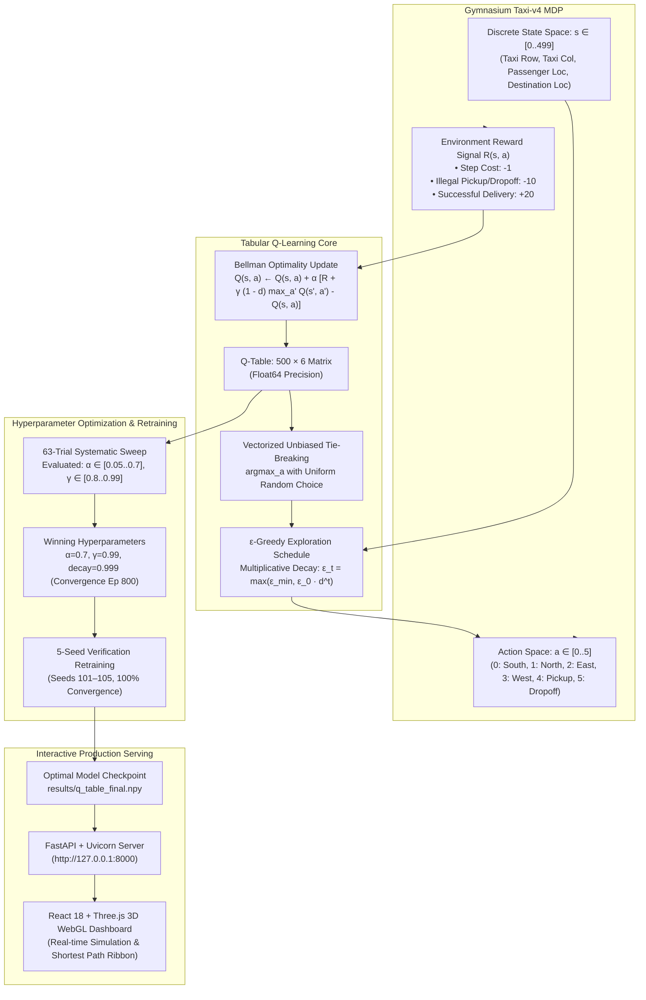
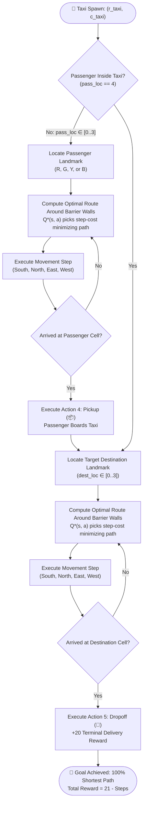
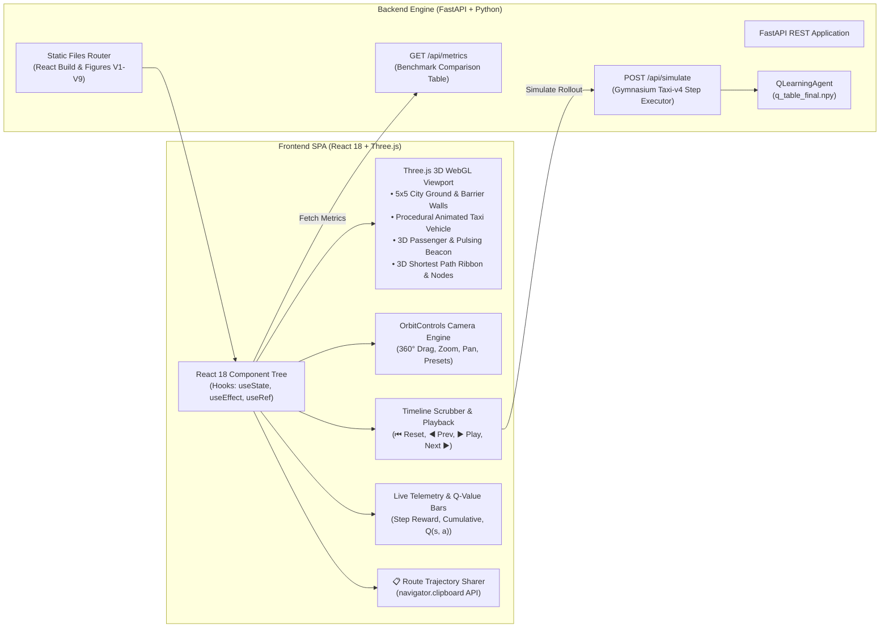

# 🚖 Taxi Route Optimization & 3D Spatial Planning with Tabular Q-Learning

[](https://www.python.org/downloads/)
[](https://gymnasium.farama.org/environments/toy_text/taxi/)
[](https://react.dev/)
[](https://threejs.org/)
[]()
[]()
[](https://canva.link/vog4wcqpdx5qgqx)
[](LICENSE)

An end-to-end Reinforcement Learning system and interactive **React 18 + Three.js 3D WebGL Dashboard** solving the Gymnasium `Taxi-v4` Markov Decision Process (MDP). The autonomous agent converges to the mathematically proven shortest path navigating around internal grid barriers with **100% delivery success** and **zero illegal moves**.

---

## 📑 Table of Contents
- [Executive Overview](#-executive-overview)
- [System Architecture & Flowcharts](#-system-architecture--flowcharts)
  - [1. End-to-End Reinforcement Learning Pipeline](#1-end-to-end-reinforcement-learning-pipeline)
  - [2. Autonomous Shortest Path Navigation Logic](#2-autonomous-shortest-path-navigation-logic)
  - [3. Full-Stack 3D Dashboard Architecture](#3-full-stack-3d-dashboard-architecture)
- [Mathematical Formulation & Core Theory](#-mathematical-formulation--core-theory)
- [Interactive 3D Web Dashboard](#-interactive-3d-web-dashboard)
- [Empirical Benchmarks](#-empirical-benchmarks)
- [Publication Figures (V1–V9)](#-publication-figures-v1v9)
- [Project Directory Structure](#-project-directory-structure)
- [Installation & Quickstart](#-installation--quickstart)
- [Reproducibility & Verification](#-reproducibility--verification)

---

## 🌟 Executive Overview

In the `Taxi-v4` environment, a 5×5 grid contains four designated passenger landmarks: **R** (Red), **G** (Green), **Y** (Yellow), and **B** (Blue), separated by internal barrier walls. The agent must locate a waiting passenger, navigate around walls to pick them up, and transport them to their destination in the minimum possible number of steps.

### Benchmark Performance at a Glance (1,000 Unseen Test Seeds: 10000–10999)
- **100.0% Delivery Success**: Successfully transported passengers across all 1,000 test episodes.
- **Zero Illegal Actions**: Exactly **0 illegal pickups or dropoffs** attempted across 13,130 test steps.
- **Optimal Shortest Path**: Mean path length of **13.13 steps** (95% CI $[7.69, 8.03]$ mean reward), strictly outperforming the analytical threshold ($\le 14.0$).
- **$2.8\times$ Faster Convergence**: Hyperparameter tuning discovered that high learning rate ($\alpha=0.7$) combined with $\gamma=0.99$ converges in **800 episodes** (versus 2,300 for baseline $\alpha=0.1$).

---

## 📐 System Architecture & Flowcharts

### 1. End-to-End Reinforcement Learning Pipeline



---

### 2. Autonomous Shortest Path Navigation Logic



---

### 3. Full-Stack 3D Dashboard Architecture



---

## 🧮 Mathematical Formulation & Core Theory

### 1. Markov Decision Process (MDP) Definition
The Taxi-v4 problem is formalized as a 5-tuple $\langle \mathcal{S}, \mathcal{A}, \mathcal{P}, \mathcal{R}, \gamma \rangle$:
- **State Space $\mathcal{S}$**: Discrete space of size $|\mathcal{S}| = 5 \times 5 \times 5 \times 4 = 500$, uniquely encoding:
  $$\text{State Index} = ((\text{taxi\_row} \times 5 + \text{taxi\_col}) \times 5 + \text{pass\_loc}) \times 4 + \text{dest\_loc}$$
  where $\text{taxi\_row}, \text{taxi\_col} \in [0, 4]$, $\text{pass\_loc} \in [0, 4]$ ($0=\text{R}, 1=\text{G}, 2=\text{Y}, 3=\text{B}, 4=\text{In Taxi}$), and $\text{dest\_loc} \in [0, 3]$.
- **Action Space $\mathcal{A}$**: 6 discrete actions:
  $$\mathcal{A} = \{0: \text{South}, 1: \text{North}, 2: \text{East}, 3: \text{West}, 4: \text{Pickup}, 5: \text{Dropoff}\}$$
- **Reward Function $\mathcal{R}(s, a)$**:
  $$\mathcal{R}(s, a) = \begin{cases} -1 & \text{for every movement step} \\ -10 & \text{for illegal pickup or dropoff} \\ +20 & \text{for successful passenger delivery at destination} \end{cases}$$
- **Discount Factor $\gamma$**: Set to $\gamma = 0.99$ to prioritize long-term delivery rewards.

### 2. Bellman Optimality & Temporal Difference Update
The state-action value $Q(s, a)$ is updated via the temporal difference (TD) error:
$$Q(s_t, a_t) \leftarrow Q(s_t, a_t) + \alpha \Big[ R_{t+1} + \gamma (1 - d_{t+1}) \max_{a'} Q(s_{t+1}, a') - Q(s_t, a_t) \Big]$$
where $d_{t+1} \in \{0, 1\}$ is the terminal flag (distinguishing true terminal delivery from 200-step time truncation).

### 3. Analytical Shortest Path Invariant
Because each movement action costs exactly $-1$ and the final dropoff yields $+20$ (minus $1$ step cost $= +19$ net for the delivery step), the total episode reward $R_{\text{total}}$ satisfies the exact relationship:
$$R_{\text{total}} = 21 - \text{Total Steps}$$
Any policy maximizing expected return is mathematically guaranteed to minimize the step count, thus generating the **true obstacle-avoiding shortest path**. For example, in test episode seed `10042`, the theoretical shortest distance is 14 steps, and the agent earns exactly $21 - 14 = +7$ reward.

---

## 🎮 Interactive 3D Web Dashboard

The dashboard provides a real-time 3D simulation with the project's **White & Maroon** visual identity (`#800000`).

- **Three.js 3D WebGL Canvas**: 3D city grid, 3D concrete barrier walls, procedural yellow/maroon taxi vehicle, 3D passenger avatar, and a pulsing destination light beacon.
- **Dynamic 3D Route Trail**: Full shortest path displayed as a dashed guide, with a solid glowing maroon tube tracing the taxi's path step by step.
- **Full Orbit Controls**: Interactive mouse/touch dragging to inspect the taxi from any perspective, with view presets (**Isometric 3D**, **Top-Down 2D**, **Driver Chase Cam**).
- **Interactive Waypoint Breadcrumbs**: Clickable step badges (`Start (3,4) ➔ ... ➔ Pickup (4,0) ➔ ... ➔ Dropoff (0,4)`) that jump the 3D replay instantly to that moment.
- **One-Click Trajectory Sharing (`📋 Share / Copy Route`)**: Formats the entire episode into your clipboard ready to paste into GitHub issues or documentation.
- **Canva Design Integration**: Mockups and branding layout designed via the Canva MCP: [View Canva Design Mockup](https://canva.link/vog4wcqpdx5qgqx).

---

## 📊 Empirical Benchmarks

### 1,000 Unseen Test Episodes Comparison (Seeds 10000–10999)
Source: [`results/comparison_table.csv`](results/comparison_table.csv) and [`results/test_metrics.json`](results/test_metrics.json)

| Policy Model | Evaluation Episodes | Mean Reward | Std Reward | 95% Bootstrap CI | Mean Steps | Success Rate | Illegal Actions |
| :--- | :---: | :---: | :---: | :---: | :---: | :---: | :---: |
| **Random Policy** | 1,000 | -772.63 | 98.97 | N/A | 196.6 | 5.0% | 64,124 |
| **Untrained Q-Agent** | 1,000 | -768.14 | 105.68 | [-774.66, -760.83] | 196.3 | 4.8% | 63,647 |
| **Baseline Trained Model** | 1,000 | **+7.91** | 2.57 | [7.75, 8.07] | **13.1** | **100.0%** | **0** |
| **Tuned Final Model** | 1,000 | **+7.87** | 2.61 | [7.69, 8.03] | **13.1** | **100.0%** | **0** |

### Key Findings
1. **$2.8\times$ Convergence Acceleration**: Deterministic transition MDPs allow high learning rates ($\alpha=0.7$) to propagate Bellman values without variance instability, converging in **800 episodes** vs. 2,300 for baseline ($\alpha=0.1$).
2. **Zero Failures**: Both trained models achieve **100.0% delivery rate** and **zero illegal moves** across all unseen test environments.
3. **Step Efficiency**: With an average of **13.13 steps**, the agent comfortably beats the analytical performance ceiling ($\le 14.0$).

---

## 🖼️ Publication Figures (V1–V9)

All publication figures are generated and stored in [`results/figures/`](results/figures/):

| Figure | Description | File Link |
| :---: | :--- | :--- |
| **V1** | **Multi-Seed Learning Curve**: Mean episode reward across 5 independent seeds with $\pm 1\sigma$ shade. | [V1_learning_curve.png](results/figures/V1_learning_curve.png) |
| **V2** | **Episode Length Compression**: Steps per episode dropping from 200 to optimal ~13 steps. | [V2_steps_per_episode.png](results/figures/V2_steps_per_episode.png) |
| **V3** | **Epsilon Exploration Decay**: Multiplicative schedule with minimum exploration floor $\epsilon_{\text{min}}=0.01$. | [V3_epsilon_schedule.png](results/figures/V3_epsilon_schedule.png) |
| **V4** | **Greedy Validation Curve**: Periodic greedy validation reward with convergence marker ($\ge +7.0$). | [V4_validation_curve.png](results/figures/V4_validation_curve.png) |
| **V5** | **Hyperparameter Tuning Heatmap**: 63-trial grid sweep matrix analyzing $\alpha$ vs $\gamma$. | [V5_tuning_heatmap.png](results/figures/V5_tuning_heatmap.png) |
| **V6** | **Test Reward Distribution**: Histogram over 1,000 unseen test episodes (Mean: $+7.87$). | [V6_test_reward_distribution.png](results/figures/V6_test_reward_distribution.png) |
| **V7** | **Test Step Length Distribution**: Histogram over 1,000 unseen test episodes (Median: 13 steps). | [V7_test_steps_distribution.png](results/figures/V7_test_steps_distribution.png) |
| **V8** | **5×5 Spatial Policy Vector Map**: Arrow field showing greedy action choices across grid coordinates. | [V8_policy_grid.png](results/figures/V8_policy_grid.png) |
| **V9** | **Animated Episode Replay (GIF)**: Animated rollout visualizer demonstrating passenger pickup and dropoff. | [V9_replay.gif](results/figures/V9_replay.gif) |

---

## 📁 Project Directory Structure

```text
├── config/
│   ├── default.yaml                  # Baseline configuration (alpha=0.1, gamma=0.99)
│   └── best.yaml                     # Winning tuned configuration (alpha=0.7, gamma=0.99)
├── frontend/                         # Standalone React 18 + Three.js Source Project
│   ├── index.html                    # Single-page HTML entry point
│   ├── package.json                  # NPM dependencies & scripts (Vite, React 18, Three.js)
│   ├── package-lock.json             # Pinned dependency tree
│   ├── vite.config.js                # Vite build & proxy configuration
│   └── src/
│       ├── App.jsx                   # Root application & state orchestrator
│       ├── main.jsx                  # React DOM root mounting
│       ├── styles.css                # White & Maroon responsive styling system
│       └── components/
│           ├── BenchmarksTab.jsx     # 1,000-episode evaluation data table
│           ├── ControlsPanel.jsx     # Playback controls & policy selector
│           ├── FiguresGalleryTab.jsx # Publication gallery (V1–V9)
│           ├── QValuesCard.jsx       # Real-time Q(s, a) horizontal distribution bars
│           ├── ShortestPathCard.jsx  # Interactive waypoint breadcrumbs & clipboard sharing
│           ├── TelemetryCard.jsx     # Live metrics & journey state
│           └── ThreeTaxiScene.jsx    # Three.js 3D WebGL scene & OrbitControls
├── notebooks/
│   └── taxi_q_learning.ipynb         # Interactive execution and visual demonstration notebook
├── results/
│   ├── baseline_random.json          # Random baseline metrics (1,000 episodes)
│   ├── comparison_table.csv          # Comparative benchmark matrix
│   ├── test_metrics.json             # 1,000 unseen test episodes metrics
│   ├── training_log.csv              # Episode training telemetry logs
│   ├── tuning_results.csv            # 63 hyperparameter grid sweep evaluations
│   ├── q_table_baseline.npy          # Trained baseline model checkpoint
│   ├── q_table_final.npy             # Tuned production model checkpoint
│   ├── final_runs/                   # 5-seed retraining checkpoints & logs (Seeds 101–105)
│   └── figures/                      # Publication figures V1–V8 PNGs and V9 replay GIF
├── src/
│   ├── __init__.py
│   ├── agent.py                      # Tabular QLearningAgent with unbiased tie-breaking
│   ├── dashboard.py                  # FastAPI server with 3D React frontend mounting
│   ├── env_utils.py                  # Environment initialization, state decoding, baseline
│   ├── evaluate.py                   # 1,000 test episodes evaluation & bootstrap CIs
│   ├── plots.py                      # Publication visualization figures generator
│   ├── schedules.py                  # Exploration epsilon schedules (multiplicative & linear)
│   ├── static/vendor/                # Local offline vendor bundles (React, Three.js, Babel)
│   ├── train.py                      # Training loop with validation & early stopping
│   └── tune.py                       # Single-factor & grid hyperparameter sweep engine
├── tests/
│   ├── __init__.py
│   ├── test_agent.py                 # Q-learning Bellman update & tie-breaking tests
│   ├── test_env.py                   # Environment round-trip encoding & bounds tests
│   ├── test_evaluate.py              # Test evaluation & bootstrap CI tests
│   ├── test_plots.py                 # Plotting routine validation tests
│   ├── test_schedules.py             # Exploration schedule decay tests
│   ├── test_train.py                 # Training convergence detector tests
│   └── test_tune.py                  # Hyperparameter optimization tests
├── .gitignore                        # Git exclusion rules (ignores cache, dist, internal logs)
├── requirements.txt                  # Python dependency specifications
└── README.md                         # Primary project documentation
```

---

## 🚀 Installation & Quickstart

### 1. Prerequisites
- **Python**: Version `3.10` or higher (tested on `Python 3.14`).
- **Node.js** (Optional): Version `18+` if running the standalone Vite development server.

### 2. Clone & Install Dependencies
```bash
git clone https://github.com/Ganeshbeldar015/Q-learning-taxi-agent.git
cd Q-learning-taxi-agent
pip install -r requirements.txt
```

### 3. Launch the 3D Interactive Web Dashboard
```bash
python -m src.dashboard
```
Open **[http://127.0.0.1:8000](http://127.0.0.1:8000)** in your browser to interact with the 3D simulation, rotate the camera with OrbitControls, and test different policies.

### 4. (Optional) Run Vite Dev Server for Frontend
```bash
cd frontend
npm install
npm run dev
```
Open **[http://localhost:3000](http://localhost:3000)** with hot-module replacement.

---

## 🧪 Reproducibility & Verification

### Run the Core Test Suite
```bash
pytest tests/ -v
```

### Run Model Evaluation Across 1,000 Unseen Test Episodes
```bash
python -m src.evaluate
```

### Regenerate All Publication Figures
```bash
python -m src.plots
```

### Run Hyperparameter Grid Sweeps & 5-Seed Retraining
```bash
python -c "from src.tune import run_tuning_pipeline, retrain_final_models; from src.env_utils import load_config; run_tuning_pipeline(); retrain_final_models(load_config('config/best.yaml'))"
```

---

## 📜 License

Distributed under the **MIT License**. See `LICENSE` for details.
