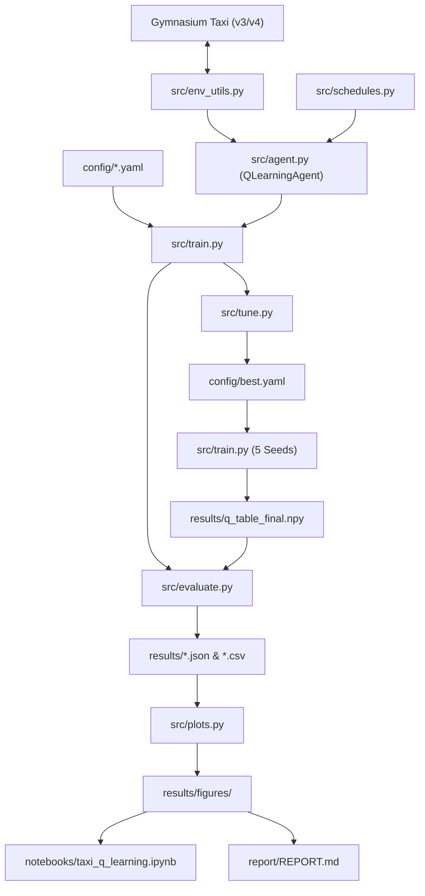

# harness.md — Taxi Route Optimization with Reinforcement Learning

> Single source of truth for the Taxi-v3/Taxi-v4 tabular Q-learning project. Derived from `docs/raw.md`.

---

## 1. Problem Statement
The goal is to develop an end-to-end, reproducible Reinforcement Learning package where a tabular Q-learning agent learns to solve the Taxi environment (Gymnasium Taxi-v3 / Taxi-v4). The agent must navigate a 5x5 grid, pick up a passenger at a specified source landmark, navigate to the target landmark, and successfully drop them off in minimal steps without executing illegal moves (-10 penalty).

Full PRD reference: [docs/raw.md](file:///D:/WorkSpace/ML%20mini%20project/docs/raw.md).

---

## 2. Goals & Non-Goals

### Goals
- Implement tabular Q-learning from scratch in NumPy (no high-level RL libraries for algorithm core).
- Epsilon-greedy exploration policy with multiplicative and linear decay schedules, with random tie-breaking.
- Hyperparameter tuning across learning rate ($\alpha$), discount factor ($\gamma$), and exploration decay schedule.
- Multi-seed training (5 distinct seeds) to ensure statistical rigor and reproducibility.
- Evaluation on 1,000 unseen test episodes with greedy policy ($\epsilon=0$).
- Benchmark against random-policy baseline and untrained agent baseline.
- Complete visual suite (learning curves, tuning heatmaps, grid policy maps, replay GIF).
- Interactive Jupyter notebook and technical report (`report/REPORT.md`).

### Non-Goals
- Deep Reinforcement Learning (DQN, PPO, actor-critic) or neural function approximators.
- Custom environments, continuous control, GPS coordinates, or non-grid maps.
- Production serving or web service deployment.

### Target Success Metrics
| Metric | Target |
|---|---|
| Greedy success rate on 1,000 unseen test episodes | 100% |
| Average reward (greedy, unseen) | $\ge 7.5$ (theoretical max: $20 - \text{steps}$) |
| Average steps to completion | $\le 14$ steps |
| Illegal pickup/drop-off actions (greedy test) | 0 |
| Convergence speed | Tuned config converges in measurably fewer episodes than baseline |
| Determinism | Fixed seed reproduces bitwise identical Q-table and metrics |

---

## 3. Users & Use Cases
- **RL Researcher / Student**: Wants clean, well-tested tabular reference implementations with verified Bellman update mathematics.
- **Academic Evaluator / Reviewer**: Wants reproducible results where every metric in the report/README maps directly to tracked JSON/CSV artifacts.
- **ML Engineer**: Wants modular code (`src/`) separated from interactive execution (`notebooks/`), with automated deterministic gates.

---

## 4. Requirements

| ID | Statement | Priority | Source |
|---|---|---|---|
| `REQ-001` | Reproducible package structure, dependencies, configuration loading (`config/default.yaml`), and seeding utilities. | MUST | raw.md §5, §7 (Phase 0) |
| `REQ-002` | Environment exploration, state decode/encode verification, and seeded random-policy baseline (1,000 episodes). | MUST | raw.md §3, §7 (Phase 1) |
| `REQ-003` | From-scratch `QLearningAgent` with Q-table, Bellman update, tie-breaking greedy action, and decay schedules. | MUST | raw.md §4, §7 (Phase 2) |
| `REQ-004` | Modular training loop with periodic validation, metrics logging (CSV), convergence detector, and model persistence. | MUST | raw.md §4, §7 (Phase 3) |
| `REQ-005` | Hyperparameter search (Stage A single-factor, Stage B grid search) with multi-worker parallelism and `config/best.yaml`. | MUST | raw.md §7 (Phase 4), §8 |
| `REQ-006` | Multi-seed final model training (5 distinct seeds) saving primary Q-table and seed checkpoints. | MUST | raw.md §7 (Phase 5) |
| `REQ-007` | Comprehensive evaluation on 1,000 unseen test episodes, comparison table, and optimal policy check. | MUST | raw.md §7 (Phase 6), §9 |
| `REQ-008` | Automated generation of publication-ready visualization figures V1–V9 saved to `results/figures/`. | MUST | raw.md §7 (Phase 7), §10 |
| `REQ-009` | Interactive Jupyter notebook, project README with reproduction guide, and detailed report (`report/REPORT.md`). | MUST | raw.md §7 (Phase 8), §11 |
| `REQ-010` | Comprehensive unit/integration test suite covering Bellman dynamics, schedules, determinism, and invariants. | MUST | raw.md §7 (Phase 9), §14 |

---

## 5. Acceptance Criteria

- **`AC-001-a`**: Given `config/default.yaml`, when loaded with schema validation, then all required training and evaluation parameters are parsed with correct types.
- **`AC-001-b`**: Given a seed integer, when initialized via `src/env_utils.py`, then a NumPy `Generator` is returned and Taxi environment reset produces repeatable observations.
- **`AC-002-a`**: Given the Taxi environment, when tested, states decode into `(taxi_row, taxi_col, pass_loc, dest)` and round-trip encode matches the original index for all 500 states.
- **`AC-002-b`**: Given a random policy evaluated over 1,000 episodes, then metrics are recorded to `results/baseline_random.json` with average reward $< -200$.
- **`AC-002-c`**: Given any successful episode with no illegal actions, the total reward strictly equals $21 - \text{steps}$.
- **`AC-003-a`**: Given a transition $(s, a, r, s')$, when `terminated=True`, the target is $r$; when `truncated=True`, the target bootstraps $\gamma \max_{a'} Q(s', a')$.
- **`AC-003-b`**: Given equal max Q-values across multiple actions, `greedy_action` breaks ties uniformly at random rather than always selecting action 0.
- **`AC-003-c`**: Given epsilon schedules (multiplicative and linear), when evaluated over episode indices, epsilon decays monotonically to `epsilon_min`.
- **`AC-004-a`**: Given `train()`, each episode logs reward, steps, epsilon, illegal moves, and success to CSV.
- **`AC-004-b`**: Given periodic evaluation every $N$ episodes on validation seeds, when greedy reward $\ge 7.0$ for `convergence_patience` checks, convergence episode is logged.
- **`AC-005-a`**: Given Stage A sweeps and Stage B grid, tuning logs results to `results/tuning_results.csv` and outputs winning parameters to `config/best.yaml`.
- **`AC-005-b`**: The best configuration demonstrates lower mean episodes-to-convergence than the baseline configuration across 5 seeds.
- **`AC-006-a`**: Given `config/best.yaml`, 5 seeds are trained; the primary Q-table is saved to `results/q_table_final.npy` selected solely by validation score.
- **`AC-007-a`**: Given 1,000 test episodes (seeds 10000–10999), greedy policy achieves $\ge 7.5$ mean reward, $\le 14$ mean steps, and 0 illegal actions.
- **`AC-007-b`**: A comparison table (`results/comparison_table.csv`) contrasts random, untrained, baseline, and tuned policies.
- **`AC-008-a`**: All figures V1–V8 (learning curves, step curves, epsilon schedule, validation convergence, tuning sweeps/heatmaps, test histograms, policy maps) exist in `results/figures/` at $\ge 150$ DPI.
- **`AC-008-b`**: Figure V9 (replay GIF of greedy episode) is generated if imageio is present.
- **`AC-009-a`**: `notebooks/taxi_q_learning.ipynb` executes end-to-end without errors and renders all figures.
- **`AC-009-b`**: `report/REPORT.md` and `README.md` cite numbers identical to saved result files in `results/`.
- **`AC-010-a`**: All pytest unit tests in `tests/` pass with zero failures and cover Bellman update, schedules, determinism, and encode/decode invariants.

---

## 6. Architecture & Tech Stack



### Technology Stack
- **Language**: Python 3.10+ (Current runtime: Python 3.14.7)
- **RL Environment**: Gymnasium (`Taxi-v4` installed, backwards compatible adapter for `Taxi-v3`)
- **Core Numerics**: NumPy ($\ge 1.26$)
- **Data & Tables**: Pandas ($\ge 2.0$)
- **Visualization**: Matplotlib ($\ge 3.8$), Seaborn ($\ge 0.13$), ImageIO
- **Testing & Verification**: Pytest ($\ge 8.0$), Ruff (linter & formatter), Mypy (type checking)
- **Interactive & Reports**: Jupyter Notebook, Markdown

---

## 7. Project Structure

```
.
├── AGENTS.md                         # Map of the harness (roles, commands, rules)
├── CLAUDE.md                         # IDE pointer to AGENTS.md
├── requirements.txt                  # Pinned dependencies
├── config/
│   ├── default.yaml                  # Baseline hyperparameter configuration
│   └── best.yaml                     # Winner produced by hyperparameter tuning
├── src/
│   ├── __init__.py
│   ├── env_utils.py                  # make_env (v3/v4 adapter), state encode/decode, seeding
│   ├── agent.py                      # QLearningAgent tabular model
│   ├── schedules.py                  # Epsilon schedules (multiplicative & linear)
│   ├── train.py                      # Training loop & convergence detection
│   ├── evaluate.py                   # Greedy evaluation and baseline comparisons
│   ├── tune.py                       # Stage A & Stage B hyperparameter search
│   └── plots.py                      # Publication visualization figures (V1-V9)
├── notebooks/
│   └── taxi_q_learning.ipynb         # Orchestrator & visualization notebook
├── tests/
│   ├── __init__.py
│   ├── test_env.py                   # State encoding, decoding, reward invariant
│   ├── test_agent.py                 # Bellman update, tie-breaking, Q-table save/load
│   ├── test_schedules.py             # Epsilon decay rates & floors
│   ├── test_train.py                 # Convergence logic, deterministic replay
│   └── harness/                      # Harness self-verification tests
├── results/
│   ├── baseline_random.json          # Random baseline metrics
│   ├── tuning_results.csv            # All trial metrics from tuning sweeps
│   ├── q_table_final.npy             # Best trained Q-table
│   ├── test_metrics.json             # 1,000 unseen test episodes metrics
│   ├── comparison_table.csv          # Policy comparative benchmarks
│   ├── figures/                      # V1 to V8 PNG plots (+ V9 GIF)
│   └── final_runs/                   # Multi-seed checkpoint logs
├── report/
│   └── REPORT.md                     # Comprehensive technical report
├── docs/
│   ├── prompt.md                     # Harness Engineering operating manual
│   ├── raw.md                        # Original PRD problem statement
│   ├── harness.md                    # This document
│   └── memory/                       # Project memory, assumptions, lessons
└── harness/                          # Harness orchestrator state, roles, tools, logs
```

---

## 8. Commands

The canonical commands agents may execute:

| Purpose | Command |
|---|---|
| install | `python -m pip install -r requirements.txt` |
| lint | `python -m ruff check src tests scripts` |
| format | `python -m ruff format --check src tests scripts` |
| typecheck | `python -m mypy src scripts --ignore-missing-imports` |
| unit test | `pytest tests/ -v -m "not slow"` |
| integration test | `pytest tests/ -v` |
| build / smoke | `python -c "import gymnasium, numpy, src.env_utils; print('Smoke OK')"` |
| harness self-test | `python scripts/check_harness.py && pytest tests/harness` |

---

## 9. Coding & Testing Standards
- **Determinism**: Every random action, environment reset, and agent exploration must be fed by an explicit `np.random.Generator`.
- **Termination vs Truncation**: Terminated state ($s \in \text{Terminal}$) zeros out future value bootstrap ($1 - \text{terminated}$). Truncated state (step $\ge 200$) continues bootstrap from $\max_{a'} Q(s', a')$.
- **Zero-Warning Policy**: Ruff must pass with 0 errors. Mypy must pass on core library routines.
- **Coverage Floor**: Minimum 85% branch coverage on `src/`.
- **Hermetic Tests**: Unit tests must not require external network connections and must execute in $< 10$ seconds total.

---

## 10. Tools, APIs & MCP Servers

| Tool | Kind | Purpose | Allowed Roles | Approval |
|---|---|---|---|---|
| `file_read` | Builtin | Reading code, configs, logs, artifacts | All | Auto |
| `file_write` | Builtin | Writing code and artifacts | Role-scoped | Auto (guarded) |
| `bash` / `powershell` | Shell | Running tests, linters, training jobs | Builder, Test-Author, QA, Orchestrator | Auto (sandboxed) |
| `git` | CLI | Branching, committing, tagging | Orchestrator, Builder | Auto (no force-push) |
| `package_install` | CLI | Installing dependencies | Builder | Confirm |
| `deploy` | CLI | Cloud or production release | None | Forbidden |

---

## 11. Autonomy & Approval Matrix

- **Autonomous (No Approval Needed)**:
  - Running linters, type checks, unit tests, and harness self-tests.
  - Creating new files within role allow-lists and artifact directories.
  - Executing training and hyperparameter search scripts within execution time budgets.
- **User Approval Required**:
  - Overwriting human hand-edited (`DRIFTED`) files.
  - Modifying `docs/raw.md` or changing core success criteria.
  - Tripping circuit breakers due to repeated stage failure or budget exhaustion.

---

## 12. Sprint Plan

| Sprint | Goal | Key Tasks | Exit Gate |
|---|---|---|---|
| **Sprint 0: Harness Scaffold** | Deterministic harness initialization & self-tests | Scaffold `harness/`, `scripts/`, `tests/harness/`, `AGENTS.md`, `profile.yaml` | `python scripts/check_harness.py && pytest tests/harness` ✅ |
| **Sprint 1: Walking Skeleton & Environment** | Env adapter, seeding, state round-trip, random baseline | `T-0001` (setup, env_utils, random baseline, tests) | G0–G4 green, `baseline_random.json` saved |
| **Sprint 2: Q-Learning Core & Training** | Agent implementation, schedules, training loop, convergence | `T-0002` (agent, schedules, train, validation loop) | Unit tests green, baseline training reaches $>6.0$ reward |
| **Sprint 3: Tuning & Final Models** | Multi-worker hyperparameter tuning & 5-seed training | `T-0003` (tune.py, best.yaml, final 5-seed runs) | `tuning_results.csv`, `q_table_final.npy` reproduced |
| **Sprint 4: Evaluation & Deliverables** | 1,000 unseen test runs, visualization V1-V9, notebook & report | `T-0004` (evaluate.py, plots.py, notebook, REPORT.md) | Success rate $100\%$, reward $\ge 7.5$, report complete |

---

## 13. Risks & Mitigations

| Risk | Impact | Mitigation |
|---|---|---|
| Timeout treated as terminal | Distorts Bellman Q-values | Strict check: bootstrap on truncation; zero bootstrap only on `terminated`. |
| Argmax bias on ties | Early exploration skewed to action 0 | Vectorized random tie-breaking among maximal actions. |
| Gymnasium Taxi-v3 deprecated in v1.0+ | `gym.make("Taxi-v3")` raises DeprecatedEnv | `src/env_utils.py` transparently supports `Taxi-v4` (identical dynamics + action masks). |
| Multi-seed training variance | Inconsistent convergence claims | Run 5 distinct seeds; select primary model strictly by validation score, never test score. |
| Hyperparameter overfit to test set | Invalid test generalization | Fixed evaluation test seeds (10000–10999) touched only once after model freezing. |

---

## 14. Assumptions

- `ASM-001` (2026-10-25, Active): The project runs on Python 3.10+ (host runtime is Python 3.14.7).
- `ASM-002` (2026-10-25, Active): Gymnasium 1.4.0 uses `Taxi-v4` which retains the exact 500-state grid, 6 actions, and reward structure (-1 step, +20 dropoff, -10 illegal) of Taxi-v3.
- `ASM-003` (2026-10-25, Active): A local virtual environment or existing global interpreter with required pinned dependencies satisfies execution needs.

---

## 15. Open Questions

*(Empty — all requirements and technical constraints from `docs/raw.md` are resolved)*

---

## 16. Definition of Done

A sprint or task is complete when:
1. All assigned acceptance criteria (`AC-*`) have corresponding automated tests or logged evidence.
2. Gates G0 (Harness), G1 (Lane), G2 (Merge), G3 (Review/Security/Docs), and G4 (QA) pass cleanly.
3. Code strictly conforms to `ruff check`, `ruff format --check`, and `mypy`.
4. Artifacts `01` through `08` are recorded with validated handoff JSONs.
5. All numerical claims in README and REPORT match tracked files in `results/`.

---

## 17. Glossary

- **Bellman Equation**: Mathematical equation expressing the value of a state-action pair as immediate reward plus discounted expected future return.
- **Epsilon-Greedy**: Exploration strategy balancing random actions (probability $\epsilon$) and greedy actions ($1-\epsilon$).
- **Terminated vs Truncated**: Terminated indicates episode end via goal achievement; truncated indicates termination via artificial step limit (200 steps).
- **Taxi-v3 / Taxi-v4**: The standard Gymnasium tabular grid environment with 500 states and 6 discrete actions.
- **Unseen Episodes**: Test episodes initialized with random seeds strictly distinct from training and validation seeds.
