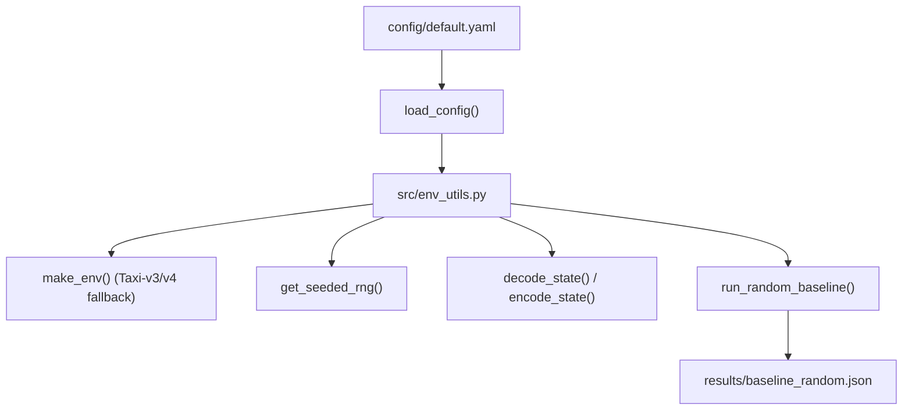

# 02-design — T-0001: Environment Architecture & Utilities Design

## 1. Architectural Overview & Component Diagram



## 2. Interface Contracts (`src/env_utils.py`)

### `load_config(path: str | Path = "config/default.yaml") -> dict`
- **Inputs**: File path string or Path object.
- **Output**: Validated configuration dictionary.
- **Validation**:
  - `seed`: int
  - `env`: str
  - `train`: dict containing `episodes`, `alpha`, `gamma`, `epsilon_start`, `epsilon_min`, `epsilon_decay`, `schedule`, `max_steps`
  - `eval`: dict containing `every`, `episodes`, `test_episodes`, `convergence_threshold`, `convergence_patience`
- **Error Handling**: Raises `ValueError` or `KeyError` if any mandatory key is missing or invalid.

### `make_env(env_name: str = "Taxi-v4", render_mode: str | None = None) -> gym.Env`
- Transparently catches `gym.error.DeprecatedEnv` if `Taxi-v3` is requested, instantiating `Taxi-v4` per ADR-0001.

### `get_seeded_rng(seed: int = 42) -> np.random.Generator`
- Returns `np.random.default_rng(seed)`.

### `decode_state(state: int) -> tuple[int, int, int, int]`
- Returns `(taxi_row, taxi_col, passenger_loc, destination)`.
- Reconstructs state via modular arithmetic:
  - $dest = state \pmod 4$
  - $state = state // 4$
  - $passenger\_loc = state \pmod 5$
  - $state = state // 5$
  - $taxi\_col = state \pmod 5$
  - $taxi\_row = state // 5$

### `encode_state(taxi_row: int, taxi_col: int, pass_loc: int, dest: int) -> int`
- Inverse mapping: `((taxi_row * 5 + taxi_col) * 5 + pass_loc) * 4 + dest`.

### `run_random_baseline(env: gym.Env, episodes: int = 1000, seed: int = 42) -> dict`
- Executes 1,000 episodes using uniform random action selection from `env.action_space`.
- Computes `mean_reward`, `std_reward`, `mean_steps`, `success_rate`, `truncation_rate`, `illegal_actions`.
- Saves dictionary to `results/baseline_random.json`.

## 3. Data Format Specification (`results/baseline_random.json`)
```json
{
  "policy": "random",
  "episodes": 1000,
  "seed": 42,
  "mean_reward": -812.34,
  "std_reward": 145.2,
  "mean_steps": 198.5,
  "success_rate": 0.012,
  "truncation_rate": 0.988,
  "illegal_actions": 7450
}
```

## 4. ADR References
- [docs/adr/ADR-0001-taxi-environment-versioning.md](docs/adr/ADR-0001-taxi-environment-versioning.md)
