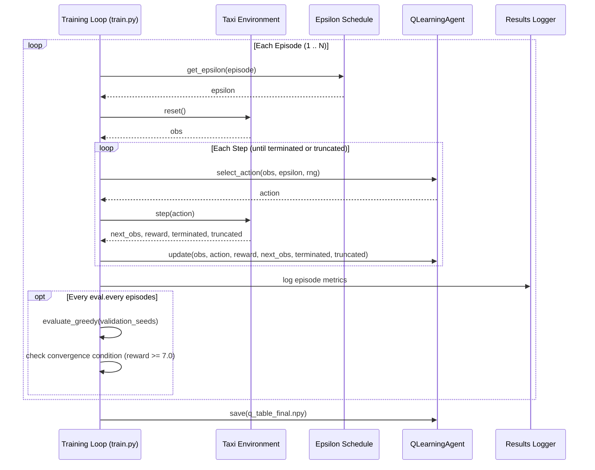

# 02-design — T-0002: Agent Architecture & Training Loop Design

## 1. System Interaction & Training Sequence



## 2. Component Interface Signatures

### `src/agent.py`
```python
class QLearningAgent:
    def __init__(self, num_states: int = 500, num_actions: int = 6, alpha: float = 0.1, gamma: float = 0.99):
        self.q_table = np.zeros((num_states, num_actions), dtype=np.float64)
        self.alpha = float(alpha)
        self.gamma = float(gamma)

    def select_action(self, state: int, epsilon: float, rng: np.random.Generator) -> int:
        if rng.random() < epsilon:
            return int(rng.integers(0, self.num_actions))
        return self.greedy_action(state, rng)

    def greedy_action(self, state: int, rng: np.random.Generator | None = None) -> int:
        q_values = self.q_table[state]
        max_val = np.max(q_values)
        candidates = np.flatnonzero(q_values == max_val)
        if len(candidates) == 1 or rng is None:
            return int(candidates[0])
        return int(rng.choice(candidates))

    def update(self, state: int, action: int, reward: float, next_state: int, terminated: bool, truncated: bool = False) -> float:
        # Bootstrapping cut off on terminated only; truncation continues bootstrap
        future_val = 0.0 if terminated else float(np.max(self.q_table[next_state]))
        td_target = reward + self.gamma * future_val
        td_error = td_target - self.q_table[state, action]
        self.q_table[state, action] += self.alpha * td_error
        return float(td_error)

    def save(self, path: str | Path) -> None:
        np.save(path, self.q_table)

    def load(self, path: str | Path) -> None:
        self.q_table = np.load(path)
```

### `src/schedules.py`
```python
class BaseSchedule:
    def get_epsilon(self, episode: int) -> float: ...

class MultiplicativeSchedule(BaseSchedule):
    def __init__(self, start: float = 1.0, min_epsilon: float = 0.01, decay: float = 0.999): ...

class LinearSchedule(BaseSchedule):
    def __init__(self, start: float = 1.0, min_epsilon: float = 0.01, decay_episodes: int = 5000): ...

def get_schedule(train_cfg: dict) -> BaseSchedule: ...
```

### `src/train.py`
```python
def evaluate_greedy(agent: QLearningAgent, env: gym.Env, episodes: int = 50, seed_offset: int = 5000) -> tuple[float, float, float]:
    """Runs pure greedy policy without Q-table updates over fixed evaluation seeds."""

def train(config: dict, env: gym.Env | None = None, log_csv_path: str | Path = "results/training_log.csv", q_table_save_path: str | Path | None = None) -> dict[str, Any]:
    """Orchestrates episodic training, logs to CSV, executes validation checks, and detects convergence."""
```

## 3. Convergence Detection Logic
- Convergence threshold: 7.0 average reward.
- Convergence patience: 3 consecutive evaluations above 7.0.
- When detected, `convergence_episode` stores the first episode of that qualifying run; otherwise `None`.
