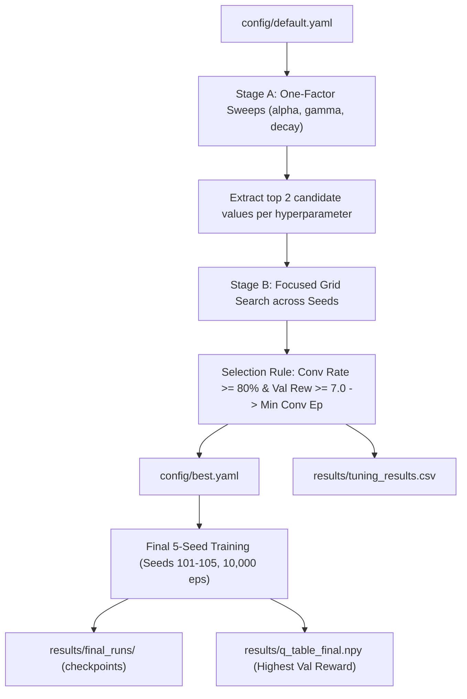

# 02-design — T-0003: Hyperparameter Search Architecture & Model Export Design

## 1. Tuning & Model Selection Flowchart

## 2. Component Interface Contracts (`src/tune.py`)

### `run_trial(params: dict, episodes: int = 3000, seed: int = 42) -> dict`
- Runs a single training run with given `alpha`, `gamma`, `epsilon_decay`, `epsilon_min`, and `seed`.
- Returns dictionary containing parameters, `converged`, `convergence_episode`, `final_validation_reward`, and `wall_clock_time`.

### `select_best_configuration(trials: list[dict], threshold: float = 7.0, min_conv_rate: float = 0.8) -> tuple[dict, pd.DataFrame]`
- Groups trials by hyperparameter tuple `(alpha, gamma, epsilon_decay, epsilon_min)`.
- Aggregates:
  - `conv_rate = sum(converged) / total_seeds`
  - `mean_conv_ep = mean(convergence_episode)`
  - `mean_val_rew = mean(final_validation_reward)`
  - `std_val_rew = std(final_validation_reward)`
- Filter: `conv_rate >= min_conv_rate` and `mean_val_rew >= threshold`.
- Sort Order:
  1. `mean_conv_ep` ascending (fastest convergence)
  2. `mean_val_rew` descending (highest reward)
  3. `std_val_rew` ascending (lowest variance)
- Returns best parameter dictionary and aggregated summary DataFrame.

### `retrain_final_models(config_path: str | Path, seeds: list[int] = [101, 102, 103, 104, 105], out_dir: str | Path = "results/final_runs", primary_out: str | Path = "results/q_table_final.npy") -> dict`
- Executes 10,000 episodes per seed using `config/best.yaml`.
- Exports each checkpoint to `results/final_runs/q_table_seed_{seed}.npy` and training log to `results/final_runs/training_log_seed_{seed}.csv`.
- Identifies seed with maximal final validation reward and copies its Q-table to `results/q_table_final.npy`.
- Returns summary dictionary of all 5 runs.
