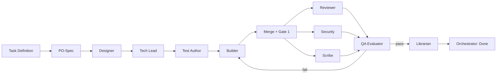

# Pipeline Workflow Specification

## Stage Graph

## Stage Progression Rules
1. **PO-Spec**: Ingests task requirements and produces `01-spec.md`.
2. **Designer**: Defines interface signatures and visualization wireframes in `02-design.md`.
3. **Tech Lead**: Produces architectural decomposition and test plan in `03-plan.md`.
4. **Test Author**: Writes failing unit tests in `tests/` and logs red run in `04-tests.md`.
5. **Builder**: Implements code in `src/` to turn tests green, logging changes in `05-build.md`.
6. **Reviewer & Security & Scribe**: Parallel audit passes producing `06-review.md`, `06b-security.md`, and `08-docs.md`.
7. **QA Evaluator**: Executes full deterministic gate suite, recording verdict in `07-qa.md`.
8. **Librarian**: Updates project memory, captures lessons learned, and refines documentation.
